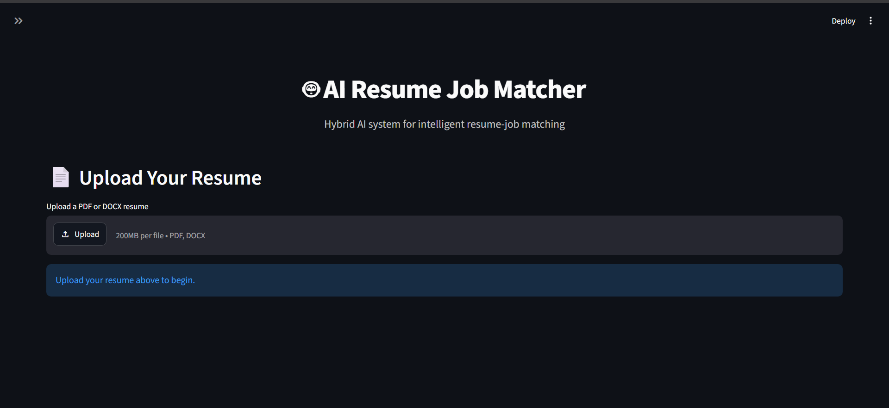
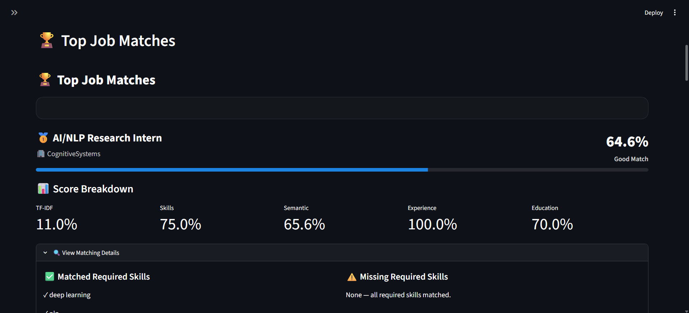
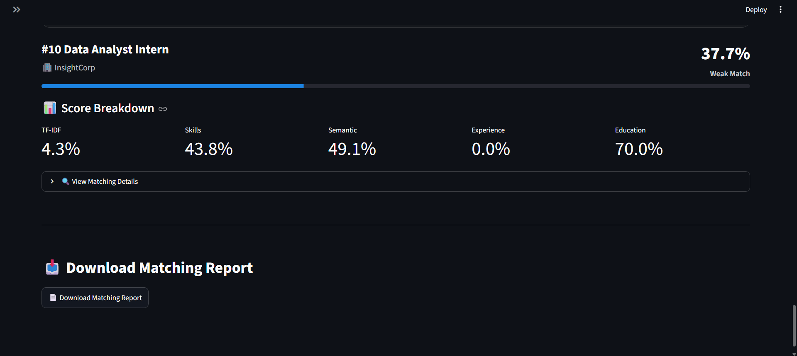
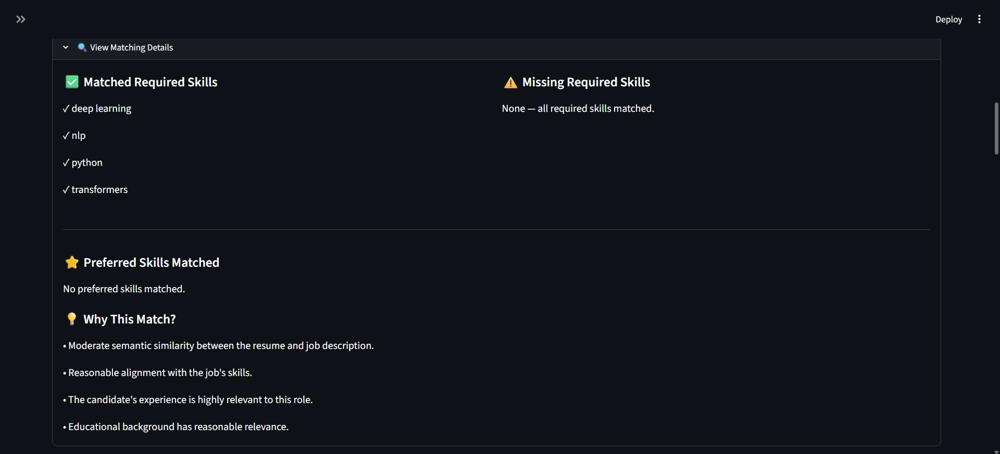

# 🤖 AI Resume Job Matcher

An AI-powered resume-to-job matching system that analyzes a candidate's resume and ranks job opportunities based on skills, semantic similarity, experience, and education.

## 🚀 Overview

The AI Resume Job Matcher takes a candidate's resume as input and produces a ranked list of relevant job opportunities.

Instead of relying on a single matching technique, the system combines multiple signals into a hybrid matching score.

The project combines:

- Classical Machine Learning
- Natural Language Processing
- Deep Learning
- Transformer-based semantic similarity
- Skill matching
- Ranking and recommendation techniques
- Explainable AI

## 🔄 Matching Pipeline

```text
Resume (PDF / DOCX)
        ↓
Resume Parser
        ↓
Resume Analyzer
        ↓
Feature Extraction
        ↓
┌──────────────────────────────┐
│ TF-IDF Similarity             │
│ Skill Matching                │
│ Transformer Semantic Score    │
│ Experience Relevance         │
│ Education Relevance         │
└──────────────────────────────┘
        ↓
Hybrid Scoring
        ↓
Job Ranking
        ↓
Explainability
        ↓
Streamlit Web Application
        ↓
Matching Report
````

## ✨ Features

* 📄 PDF and DOCX resume support
* 🔍 Automatic resume text extraction
* 🛠️ Skill extraction and matching
* 🧠 Transformer-based semantic similarity
* 📊 TF-IDF text similarity
* 💼 Experience relevance scoring
* 🎓 Education relevance scoring
* ⚖️ Hybrid job ranking
* 💡 Explainable matching results
* ⚠️ Missing-skill identification
* 📈 Score breakdown
* 📥 Downloadable matching report
* 🖥️ Interactive Streamlit interface
* 🧪 Model and ranking evaluation

## 📸 Application Screenshots

### Resume Upload

The application accepts PDF and DOCX resumes and automatically analyzes the uploaded resume.



### Top Job Matches

The system ranks job opportunities based on the hybrid matching score and displays the most relevant roles first.



### Score Breakdown

Each job match includes a detailed breakdown of TF-IDF similarity, skill matching, semantic similarity, experience relevance, and education relevance.



### Explainable Matching

The application explains why a job matches the candidate, including matched required skills, missing skills, preferred skills, and matching signals.



## 🧠 AI / ML / DL Used

### Artificial Intelligence

The overall application uses AI techniques to analyze resumes and recommend relevant job opportunities.

### Machine Learning

The project uses classical machine learning techniques including:

* TF-IDF
* Cosine similarity
* Feature-based scoring
* Hybrid relevance scoring
* Ranking evaluation

### Deep Learning

The project uses a pretrained Sentence Transformer model:

```text
all-MiniLM-L6-v2
```

The Transformer converts resume and job descriptions into numerical embeddings.

These embeddings are compared using cosine similarity to calculate semantic relevance.

## 📊 Model Evaluation

The hybrid matching system was evaluated on 50 manually labeled resume-job pairs.

### Evaluation Metrics

| Metric | Score |
|---|---:|
| Evaluation Pairs | 50 |
| Best Threshold | 26% |
| Accuracy | 58.00% |
| Precision | 52.50% |
| Recall | 91.30% |
| F1 Score | 66.67% |

### Threshold Analysis

Different matching-score thresholds were evaluated from 20% to 50%.

The threshold was selected based on the highest F1 score, which balances precision and recall.

The best-performing threshold according to F1 was **26%**.

At this threshold:

- Accuracy: **58.00%**
- Precision: **52.50%**
- Recall: **91.30%**
- F1 Score: **66.67%**

### Confusion Matrix

```text
[[ 8 19]
 [ 2 21]]
### Natural Language Processing

NLP is used throughout the project to process:

* Resume text
* Job descriptions
* Skills
* Education information
* Experience information

## 🧠 How It Works

### 1. Resume Parsing

The system accepts PDF and DOCX resumes and extracts their textual content.

### 2. Resume Analysis

Important candidate information is extracted, including:

* Name
* Skills
* Education
* Experience

### 3. Job Representation

Each job contains information such as:

* Job title
* Company
* Job description
* Required skills
* Preferred skills

The job information is combined into a representation used by the matching system.

### 4. TF-IDF Matching

TF-IDF is used to measure textual similarity between the resume and job descriptions.

This captures direct keyword and phrase overlap.

### 5. Skill Matching

Candidate skills are compared against required and preferred job skills.

The system identifies:

* Matched required skills
* Missing required skills
* Matched preferred skills

### 6. Transformer Semantic Matching

A pretrained Sentence Transformer model is used to calculate semantic similarity between the resume and job descriptions.

The model generates embeddings for the resume and job descriptions.

The embeddings are compared using cosine similarity.

This allows the system to recognize related meaning even when exact words do not match.

### 7. Experience Matching

Candidate experience is compared with job requirements to estimate experience relevance.

### 8. Education Matching

The candidate's educational background is compared with the job description.

### 9. Hybrid Scoring

The final matching score combines multiple signals:

```text
Final Score =
    TF-IDF × 0.15
  + Skills × 0.35
  + Semantic Similarity × 0.30
  + Experience × 0.10
  + Education × 0.10
```

The resulting score is used to rank jobs from most relevant to least relevant.

## 📊 Explainability

The system does not only provide a final percentage.

For every recommendation, it provides:

* Overall match score
* Score breakdown
* Matched required skills
* Missing required skills
* Matched preferred skills
* Explanation of the matching signals
* Human-readable match verdict

### Example

```text
Overall Match: 82.4%

Skills:       91%
Semantic:     78%
Experience:   80%
Education:    70%

Matched Skills:
✓ Python
✓ Machine Learning
✓ Pandas

Missing Skills:
⚠ PyTorch
```

## 🏗️ Project Structure

```text
AI-Resume-Matcher/
│
├── app.py
├── requirements.txt
├── README.md
├── .gitignore
│
├── src/
│   ├── config.py
│   ├── create_dataset.py
│   ├── resume_parser.py
│   ├── resume_analyzer.py
│   ├── baseline_matcher.py
│   ├── skill_matcher.py
│   ├── transformer_matcher.py
│   ├── experience_education_matcher.py
│   ├── hybrid_matcher.py
│   ├── skill_gap_analyzer.py
│   ├── explanation_engine.py
│   ├── evaluate_model.py
│   └── ranking_evaluation.py
│
├── data/
│   ├── evaluation/
│   ├── processed/
│   └── raw/
│
├── models/
│
├── notebooks/
│
└── tests/
```

## 🛠️ Tech Stack

### Programming Language

* Python

### Machine Learning

* Scikit-learn
* TF-IDF
* Cosine Similarity

### Deep Learning / NLP

* Sentence Transformers
* all-MiniLM-L6-v2
* Semantic Text Similarity

### Data Processing

* Pandas
* NumPy

### Document Processing

* PyPDF2
* python-docx

### Web Application

* Streamlit

## ⚙️ Installation

Clone the repository:

```bash
git clone <YOUR_GITHUB_REPOSITORY_URL>
cd AI-Resume-Matcher
```

Create a virtual environment:

```bash
python -m venv .venv
```

Activate it on Windows:

```cmd
.venv\Scripts\activate
```

Install dependencies:

```bash
pip install -r requirements.txt
```

## ▶️ Running the Application

Run the Streamlit application:

```bash
streamlit run app.py
```

The application will open in your browser.

Upload a PDF or DOCX resume and click:

```text
🚀 Analyze Resume
```

The system will analyze the resume and generate ranked job recommendations.

## 📈 Evaluation

The project includes an evaluation pipeline for measuring matching and ranking performance.

The evaluation includes metrics such as:

* Accuracy
* Precision
* Recall
* F1 Score
* Precision@K
* Recall@K
* Mean Reciprocal Rank (MRR)

Evaluation data is stored inside:

```text
data/evaluation/
```

## 🔬 Model Architecture

The system uses a hybrid approach rather than depending on a single matching technique.

The major signals are:

1. TF-IDF similarity
2. Skill matching
3. Transformer semantic similarity
4. Experience relevance
5. Education relevance

These signals are combined to produce the final job-matching score.

This approach allows the system to consider both direct keyword overlap and deeper semantic relationships between resumes and job descriptions.

## 🎯 Example Use Case

A candidate uploads their resume.

The system:

1. Extracts resume information.
2. Identifies candidate skills.
3. Compares the resume with available jobs.
4. Calculates multiple matching scores.
5. Combines them into a hybrid score.
6. Ranks the available jobs.
7. Explains why each job was recommended.
8. Identifies missing skills.
9. Generates a downloadable matching report.

## 📥 Matching Report

After analyzing a resume, the application provides a downloadable report containing:

* Candidate information
* Detected skills
* Top job recommendations
* Match scores
* TF-IDF scores
* Skill scores
* Semantic scores
* Experience scores
* Education scores
* Matched skills
* Missing skills
* Matching explanations

## 🧪 Testing

The application has been tested with:

* PDF resumes
* DOCX resumes
* Complete resumes
* Incomplete resumes
* Resumes with missing experience information
* Resumes with missing project information

The system is designed to handle resumes with missing sections without crashing.

## ⚡ Model Optimization

The Transformer model is loaded through a reusable model-loading function so that it can be reused during repeated matching operations within the same Python process.

This reduces unnecessary model initialization overhead.

## ⚠️ Limitations

This project is a functional prototype and has several limitations:

* Matching quality depends on the quality of the job dataset.
* Skill extraction may miss skills written in unusual formats.
* Resume formatting can affect text extraction.
* The hybrid score weights are manually configured.
* The Transformer model is pretrained rather than fine-tuned specifically for recruitment.
* The current dataset is limited compared with a production-scale recruitment system.
* Recommendations should support human decision-making rather than replace it.

## 🔮 Future Improvements

Possible future improvements include:

* Larger real-world job dataset
* More advanced skill and entity extraction
* Fine-tuning a domain-specific Transformer model
* Learning hybrid weights automatically
* Vector database integration
* Duplicate job detection
* Personalized job recommendations
* User accounts and saved jobs
* Job application tracking
* REST API
* Cloud deployment
* Automated model monitoring

## 🚀 Future Scope

The system can be extended into a larger recruitment platform by adding:

* Real-time job APIs
* Candidate profiles
* Job recommendation history
* Personalized recommendations
* Resume improvement suggestions
* Skill-learning recommendations
* Recruiter dashboards
* Cloud-based inference
* REST API integration

## 📌 Project Status

**Status: Functional Prototype**

The project currently supports:

* Resume upload
* PDF and DOCX parsing
* Resume analysis
* Skill extraction
* Hybrid AI matching
* Job ranking
* Explainable recommendations
* Skill-gap analysis
* Model evaluation
* Interactive Streamlit interface
* Downloadable matching report

## 📚 Key Learning Outcomes

This project demonstrates practical experience with:

* Machine Learning
* Natural Language Processing
* Deep Learning
* Transformer models
* Information retrieval
* Feature engineering
* Similarity-based recommendation
* Ranking systems
* Model evaluation
* Explainable AI
* Python application development
* Streamlit application development

## 👨‍💻 Author

Jismeet singh

This project was developed as an AI/ML portfolio project demonstrating practical implementation of NLP, machine learning, deep learning, semantic similarity, ranking, and explainable AI.

## 📄 License

This project is intended for educational and portfolio purposes.

```